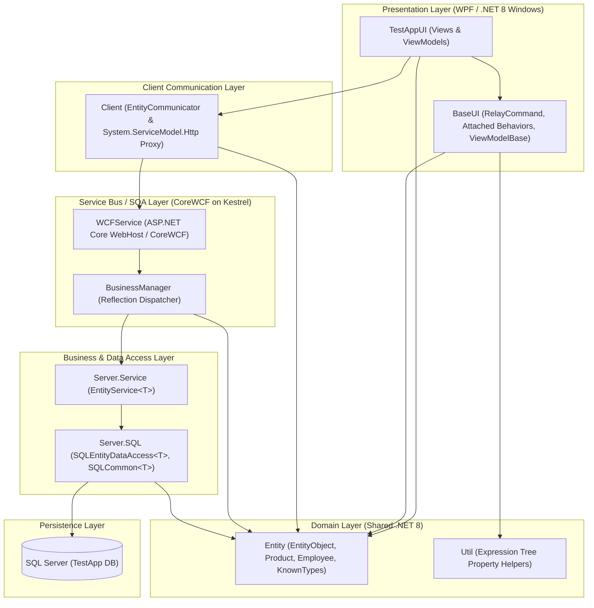

# NTier-Mvvm-Backend-Api-Orm: Enterprise N-Tier Architecture Showcase

[-blue.svg)](https://dotnet.microsoft.com/)
[](https://github.com/CoreWCF/CoreWCF)
[](#architecture-overview)
[](#running-unit-tests)
[](https://github.com/moq/moq4)
[](#)

A comprehensive reference implementation demonstrating an end-to-end **N-Tier enterprise architecture** modernized to **.NET 8 (LTS)**.

This project showcases clean separation of concerns, decoupling the desktop presentation layer (**WPF** with **MVVM**) from the service bus (**CoreWCF** on ASP.NET Core Kestrel) and data access layers (**Custom Lightweight ORM + Microsoft.Data.SqlClient**), alongside advanced C# language features, reflection-based service routing, and concurrency patterns.

---

## Architecture Overview



---

## Solution Structure

The Visual Studio / .NET 8 solution (`TestApp.sln`) is modularized into 9 dedicated projects:

| Project | Target | Description |
| :--- | :--- | :--- |
| **`TestAppUI`** | `net8.0-windows` (WPF) | Desktop UI containing Views (`MainView`, `ProductView`, `EmployeeView`), ViewModels, and styles. Demonstrates data binding, validation styling, and asynchronous operations. |
| **`BaseUI`** | `net8.0-windows` (WPF) | Core MVVM infrastructure: `EntityViewModel` with strongly typed `INotifyPropertyChanged`, `RelayCommand` implementation, and attached behavior `MouseDoubleClick.Command`. |
| **`Entity`** | `net8.0` | Shared domain entities (`EntityObject`, `ProductEntity`, `EmployeeEntity`). Features dynamic `[KnownType]` resolution for polymorphic CoreWCF serialization and `IDataErrorInfo` for validation. |
| **`Client`** | `net8.0` | Encapsulates modern WCF client proxies (`System.ServiceModel.Http`) through `EntityCommunicator`, providing strongly typed generic API methods (`GetAll<T>`, `GetById<T>`, `GetByTemplate<T>`). |
| **`WCFService`** | `net8.0` (ASP.NET Core / CoreWCF) | Hosted CoreWCF SOAP service on Kestrel (`/EntityWCFService.svc`) with `IEntityWCFService`. Uses `BusinessManager` to dynamically locate and invoke matching service implementations via reflection. |
| **`Server`** | `net8.0` | Server-side business logic and Data Access Layer (DAL) powered by `Microsoft.Data.SqlClient`. Implements `EntityService<T>` and custom ADO.NET querying logic (`SQLEntityDataAccess<T>`). |
| **`Util`** | `net8.0` | Utilities such as lambda expression tree helpers (`Expression<Func<T>>.GetPropertyName()`) to avoid hardcoded property strings. |
| **`Database`** | SQL Server Project | Database schema project (`.sqlproj` / `.dacpac`) defining tables (`Product`, `Employee`), deployment manifests, and post-deployment seed scripts. |
| **`TestApp.Tests`** | `net8.0-windows` (MSTest + Moq) | Comprehensive test suite with **101 unit tests** covering all layers, contracts, MVVM behaviors, custom ORM SQL generators, and Moq-isolated interfaces. |

---

## Key Highlights & Modernization

### 1. Modernized to .NET 8 (LTS) & CoreWCF
- Migrated legacy WCF server (`System.ServiceModel` hosted in IIS) to **CoreWCF 1.9** on top of modern ASP.NET Core Kestrel (`Microsoft.NET.Sdk.Web`).
- Replaced legacy client bindings with modern `System.ServiceModel.Http` (v8.1.2) client proxies.
- Migrated ADO.NET data access from legacy `System.Data.SqlClient` to **`Microsoft.Data.SqlClient`** (v5.2.2).
- Clean SDK-style project formats across all C# projects.

### 2. MVVM with Expression-Based Property Notification & Behaviors
- **Type-safe property change notifications:** Eliminates magic strings by extracting property names directly from expressions:
  ```csharp
  OnPropertyChange(() => Products);
  ```
- **Attached Behavior pattern:** `MouseDoubleClick` allows binding ListView item double-click actions directly to `ICommand` without polluting view code-behind.
- **Client-Side Validation:** `IDataErrorInfo` implemented directly on domain models, allowing WPF controls to automatically highlight validation errors.

### 3. Reflection-Driven Generic CoreWCF Services & KnownTypes
- **Polymorphic Serialization:** `EntityObject` leverages `[KnownType("GetKnownTypes")]` to inspect loaded assemblies dynamically, enabling seamless serialization of derived entities without hardcoded attributes.
- **Dynamic Service Dispatcher:** `BusinessManager` automatically resolves generic services (`EntityService<T>`) for requested entity types at runtime without monolithic switch/case blocks.

### 4. Custom Query-by-Example ORM
- **Attribute-Driven Mapping:** Automatically maps SQL reader columns to entity properties annotated with `[DataMember]`.
- **Query By Example (QBE):** `CreateWhereClause` inspects non-default property values of entity templates to construct parameterized SQL queries on the fly.

### 5. Concurrency & Asynchronous Programming Laboratory
`MainViewModel` includes implementations comparing 4 threading approaches in .NET:
- **`Task`** (Task Parallel Library - TPL)
- **`Thread`** (low-level managed thread with custom `ThreadInfo` and callbacks)
- **`BackgroundWorker`** (with progress updates dispatched to `ProgressBar` and `RunWorkerCompleted`)
- **`ThreadPool`** (`ThreadPool.QueueUserWorkItem`)

---

## Getting Started

### Prerequisites
- **.NET 8 SDK** (v8.0.x or newer).
- **SQL Server** (LocalDB, SQL Express, or Docker container).

### Build & Run
1. **Restore and Build:**
   ```bash
   dotnet build TestApp.sln
   ```
2. **Start the CoreWCF Service:**
   ```bash
   dotnet run --project WCFService/WCFService.csproj
   ```
   The service listens on `http://localhost:5000/EntityWCFService.svc`.
3. **Start the WPF Client Application:**
   ```bash
   dotnet run --project TestAppUI/TestAppUI.csproj
   ```

### Running Unit Tests
The solution includes **101 automated unit tests** in `TestApp.Tests` with **Moq** mocking across all architectural boundaries:
- **Domain Entities & Validation:** Property contracts, `IDataErrorInfo` validation rules, `[KnownType]` reflection discovery.
- **Expression Utilities:** `GetPropertyName` lambda reflection and error handling.
- **MVVM Infrastructure:** `RelayCommand` execution/predicates, `EntityViewModel` property change event dispatching, STA mouse double-click attached behaviors.
- **Custom ORM Query Generator:** Dynamic parameterized `WHERE` clause creation with AND/OR conditions and SQL command builders.
- **CoreWCF Service Contracts & Reflection:** Serialization attributes, dispatch reflection mechanics, interface contract verification.
- **Mocked Architectural Boundaries:** `IEntityWCFServiceChannel`, `IClientChannel`, `IDataErrorInfo` isolated tests with `Moq`.

Run all tests via .NET CLI:
```bash
dotnet test
```

---

## Author
- **Dawid Domagała** ([DavIT-Futures](https://github.com/DavIT-Futures))
