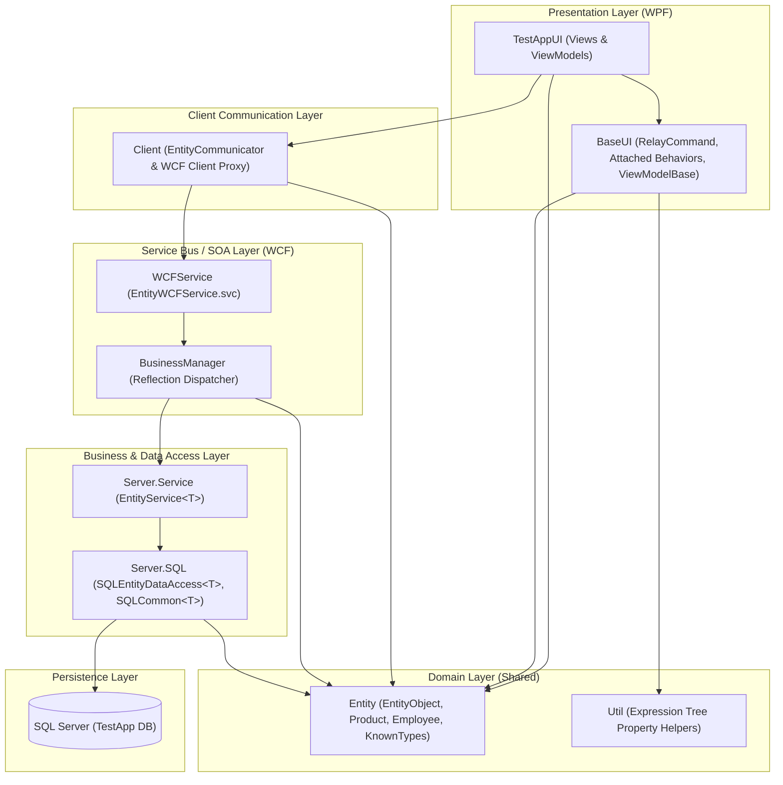

# Enterprise N-Tier Architecture Showcase (WPF & WCF)

[](https://dotnet.microsoft.com/)
[](#architecture-overview)
[](#)

A comprehensive reference implementation and Proof of Concept (PoC) demonstrating an end-to-end **N-Tier enterprise architecture** built on **.NET Framework 4.5**.

This project showcases clean separation of concerns, decoupling the presentation layer (**WPF** with **MVVM**) from the backend services (**WCF**) and business/data access layers (**Custom Lightweight ORM + SQL Server**), alongside advanced C# language features, reflection-based service routing, and concurrency patterns.

---

## Architecture Overview



---

## Solution Structure

The Visual Studio solution (`TestApp.sln`) is modularized into 8 dedicated projects:

| Project | Type | Description |
| :--- | :--- | :--- |
| **`TestAppUI`** | WPF Application | Desktop UI containing Views (`MainView`, `ProductView`, `EmployeeView`), ViewModels, and styles. Demonstrates data binding, validation styling, and asynchronous operations. |
| **`BaseUI`** | Class Library | Core MVVM infrastructure: `EntityViewModel` with strongly typed `INotifyPropertyChanged`, `RelayCommand` implementation, and attached behavior `MouseDoubleClick.Command`. |
| **`Entity`** | Class Library | Shared domain entities (`EntityObject`, `ProductEntity`, `EmployeeEntity`). Features dynamic `[KnownType]` resolution for polymorphic WCF serialization and `IDataErrorInfo` for validation. |
| **`Client`** | Class Library | Encapsulates WCF service client proxies through `EntityCommunicator`, providing strongly typed generic API methods (`GetAll<T>`, `GetById<T>`, `GetByTemplate<T>`). |
| **`WCFService`** | WCF Service Application | Hosted WCF SOAP service (`EntityWCFService.svc`) with `IEntityWCFService`. Uses `BusinessManager` to dynamically locate and invoke matching service implementations via reflection. |
| **`Server`** | Class Library | Server-side business logic and Data Access Layer (DAL). Implements `EntityService<T>` and custom ADO.NET querying logic (`SQLEntityDataAccess<T>`). |
| **`Util`** | Class Library | Utilities such as lambda expression tree helpers (`Expression<Func<T>>.GetPropertyName()`) to avoid hardcoded property strings. |
| **`Database`** | SQL Server Project | Database schema project (`.sqlproj` / `.dacpac`) defining tables (`Product`, `Employee`), deployment manifests, and post-deployment seed scripts. |

---

## Key Highlights & Patterns

### 1. MVVM with Expression-Based Property Notification & Behaviors
- **Type-safe property change notifications:** Eliminates magic strings by extracting property names directly from expressions:
  ```csharp
  OnPropertyChange(() => Products);
  ```
- **Attached Behavior pattern:** `MouseDoubleClick` allows binding ListView item double-click actions directly to `ICommand` without polluting view code-behind.
- **Client-Side Validation:** `IDataErrorInfo` implemented directly on domain models, allowing WPF controls to automatically highlight validation errors.

### 2. Reflection-Driven Generic WCF Services & KnownTypes
- **Polymorphic Serialization:** `EntityObject` leverages `[KnownType("GetKnownTypes")]` to inspect loaded assemblies dynamically, enabling seamless WCF serialization of derived entities without hardcoded attributes.
- **Dynamic Service Dispatcher:** `BusinessManager` automatically resolves generic services (`EntityService<T>`) for requested entity types at runtime without monolithic switch/case blocks.

### 3. Custom Query-by-Example ORM
- **Attribute-Driven Mapping:** Automatically maps SQL reader columns to entity properties annotated with `[DataMember]`.
- **Query By Example (QBE):** `CreateWhereClause` inspects non-default property values of entity templates to construct parameterized SQL queries on the fly.

### 4. Concurrency & Asynchronous Programming Laboratory
`MainViewModel` includes implementations comparing 4 threading approaches in .NET:
- **`Task`** (Task Parallel Library - TPL)
- **`Thread`** (low-level managed thread with custom `ThreadInfo` and callbacks)
- **`BackgroundWorker`** (with progress updates dispatched to `ProgressBar` and `RunWorkerCompleted`)
- **`ThreadPool`** (`ThreadPool.QueueUserWorkItem`)

### 5. Advanced C# Language Features
Dedicated exploration of:
- **Covariance and Contravariance** (`IEnumerable<T>` vs list casting)
- **Anonymous Methods & Lambdas** (`delegate`, `Action`, `Func<T, TResult>`, `Predicate<T>`)
- **Expression Trees** (`System.Linq.Expressions`)

---

## Getting Started

### Prerequisites
- **Visual Studio 2012** or newer (with .NET Framework 4.5 development tools and WCF components enabled).
- **SQL Server** (LocalDB, SQL Express, or full SQL Server instance).
- **IIS** or **IIS Express** (for hosting `WCFService`).

### Setup & Configuration
1. **Database:**
   - Deploy `Database/Database.sqlproj` using Visual Studio SSDT or run `Database/sql/debug/Database.sql` against your local SQL Server instance.
2. **Connection String:**
   - Update `GetConnectionString()` in `Server/SQL/SQLCommon.cs` to match your local SQL Server connection details.
3. **WCF Service Hosting:**
   - Configure the WCF project in Visual Studio or publish to IIS.
   - Verify the client endpoint address in `TestAppUI/app.config` matches the service URL (default: `http://localhost/WCFService/EntityWCFService.svc`).
4. **Run:**
   - Set `TestAppUI` as the startup project and run (F5).

---

## Author
- **Dawid Domagała** ([DavIT-Futures](https://github.com/DavIT-Futures))
